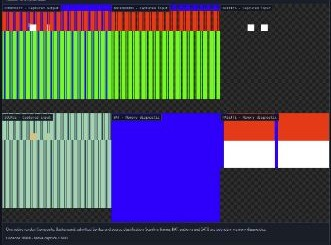
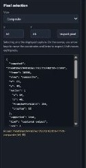
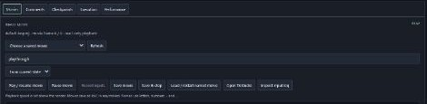
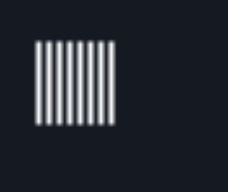

# TURBO REAPER - BizHawk

Local TurboGrafx-16 / PC Engine HuCard reverse-engineering workbench based on an isolated BizHawk 2.11.1 / PCEHawk installation.

The source build uses **BizHawk 2.11.1 / PCEHawk**. Click any crop to enlarge it. The validation report records the renderer limits and tested configurations.

| Feature | Cropped example |
| --- | --- |
| **PCEHawk graphics.** Inspect Composite, captured VDC background and admitted sprite samples. BAT, VRAM patterns, palette and SATB provide copied-memory diagnostics. Capture geometry follows the renderer, with stable 256, 320 and 512 pixel widths exercised. | <a href="docs/rea-features/graphics.jpg"></a> |
| **Pixel selection and bank context.** Pin a capture, inspect pixels and copied memory, and compare a baseline. Register and mapping context distinguishes physical domain offsets from logical HuC6280 addresses. | <a href="docs/rea-features/inspection.jpg"></a> |
| **Input movies and experiments.** Record or replay BK2 input, open native TAStudio, restore a compatible checkpoint, or step with explicit inputs. | <a href="docs/rea-features/movies.jpg"></a> |
| **Sprite and tile catalog.** Save named matches, isolate a tile or sprite group, and follow one occurrence in live play or BK2 replay. Attach the pinned frame to a comment and reopen the original catalog revision and isolation through saved evidence. Export the note with a hash manifest. | <a href="docs/rea-features/catalog.jpg"></a> |

Download the Windows x64 package from the [v0.1.0 release](https://github.com/Bertzerker/TURBO-REAPER-BizHawk/releases/tag/v0.1.0). Extract it into a fresh folder and run these commands in PowerShell 7 with Node.js 24 and the [BizHawk Windows prerequisites](https://github.com/TASEmulators/BizHawk/tree/2.11.1#installing) installed.

```powershell
./Setup.ps1
./rea/Start-REA.ps1 -Rom 'C:/path/to/game.pce' -Wait
```

Setup downloads the pinned BizHawk 2.11.1 archive and applies the guarded PCEHawk patch locally. Use `./Setup.ps1 -Archive 'C:/path/to/BizHawk-2.11.1-win-x64.zip'` to install from an existing copy. The diagnostic and harness can generate their own test inputs when supplied an installed Python 3 executable via `-Python`.

For a source checkout, build and launch the original diagnostic.

```powershell
./rea/Build.ps1
./rea/Start-REA.ps1 -Diagnostic -Mute -Python 'C:/path/to/python.exe'
```

Open <http://127.0.0.1:8920/>. See [run/API guide](rea/README.md), [core selection](rea/CORE-SELECTION.md), [specification](rea/SPEC.md), [validation](rea/VALIDATION.md), [parity](rea/PARITY.md) and [integration notes](INTEGRATION-NOTES.md).

The catalog supports standard HuCards in PCEHawk. BAT memory diagnostics support isolation only. Default ports are HTTP 8920 and native duplex stream/control 8921. CD, SuperGrafx and extended controllers are unavailable REA modes. The package contains the bridge, local patcher and harness. Supply your own HuCard image for gameplay.

BizHawk's license notice is preserved in [LICENSE.BizHawk](LICENSE.BizHawk). New original REA code is MIT licensed under [rea/LICENSE](rea/LICENSE); copied upstream components retain their existing notices and licenses.
